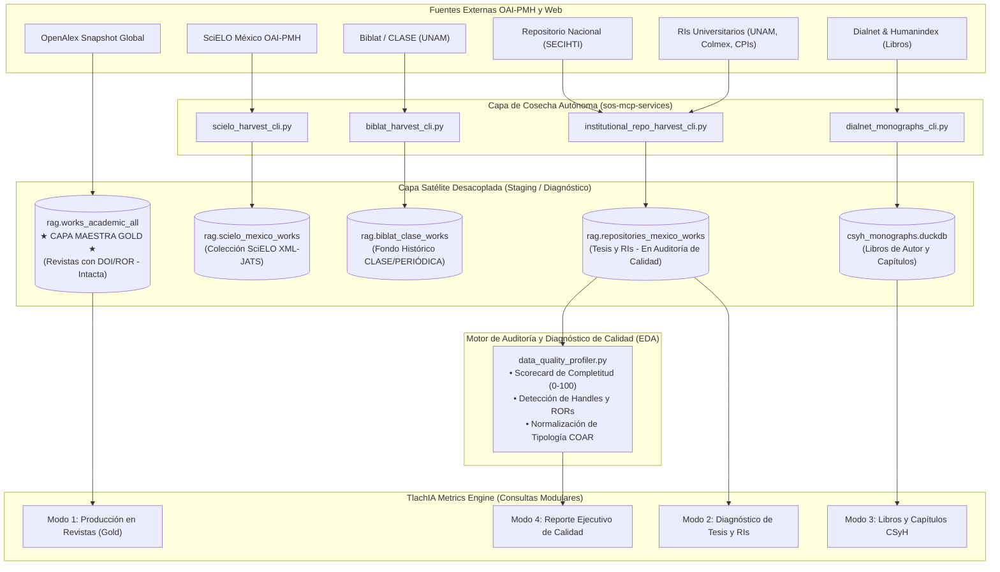
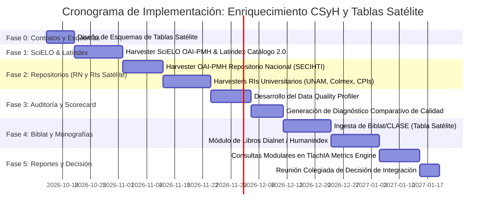

# Plan de Implementación: Enriquecimiento de TlachIA Metrics con Fuentes Regionales para Ciencias Sociales y Humanidades (CSyH) y Repositorios Institucionales 🏛️📚

**Ecosistema:** TlachIA Metrics · RevistasLATAM · SOS-MCP Services · Sinapsis AI · SECIHTI / RIZOMA
**Fecha de Actualización:** Octubre 2026 (Versión 2.0 — Arquitectura de Tablas Satélite Desacopladas)
**Documento Técnico:** `/mnt/expansion/desplegados/TlachIA-Metrics/docs/PLAN_IMPLEMENTACION_ENRIQUECIMIENTO_CSYH.md`
**Autoría:** Laboratorio de Sistemas Complejos y Cienciometría Computacional (C3 / Facultad de Ciencias, UNAM)

---

## 1. Justificación y Planteamiento del Problema

### 1.1. El Sesgo Estructural de las Grandes Bases Globales (OpenAlex, WoS, Scopus)

Aunque **OpenAlex** representa un avance sustantivo en apertura frente a las bases propietarias tradicionales (WoS y Scopus) gracias a su ingesta masiva de Crossref, DOAJ y algunos repositorios mundiales, mantiene vacíos críticos para evaluar la producción científica de **México e Iberoamérica en Ciencias Sociales y Humanidades (CSyH)**:

1. **Dependencia Extrema del DOI Comercial (Crossref):** OpenAlex estructura sus publicaciones casi exclusivamente a partir de depósitos DOI comerciales de Crossref. Una gran proporción de las revistas mexicanas de CSyH operan bajo el modelo **Acceso Abierto Diamante institucional (sin cobro al autor ni al lector)** y carecen de presupuesto recurrente para pagar el registro de DOIs en Crossref.
2. **Marginalización de la Monografía, el Capítulo y la Tesis de Posgrado:** En Humanidades (Filosofía, Historia, Letras, Arte, Arqueología) y Ciencias Sociales (Sociología, Derecho, Antropología, Ciencia Política), los formatos de máxima madurez y originalidad intelectual son el **libro de autoría única, el capítulo en libro dictaminado y la tesis de posgrado (maestría y doctorado)**, tipologías que OpenAlex y Scopus prácticamente no cubren en América Latina.
3. **Invisibilización de Circuitos Lingüísticos Nacionales y Regionales:** Los tópicos de investigación en CSyH responden a problemáticas locales y regionales cuyo vehículo comunicativo natural es el **español o portugués**, así como lenguas originarias. El cálculo de indicadores globales como el FWCI sobre corpus dominados por literatura anglosajona castiga artificialmente a estas disciplinas.
4. **Pérdida de la Citación Endógena y de Red:** Las citas generadas entre libros, monografías y revistas locales no registradas en Crossref se pierden por completo, provocando que investigadores destacados de las Áreas IV y V del SNII aparezcan con métricas de citación erróneamente deprimidas.

### 1.2. La Realidad de los Repositorios: Alta Riqueza, pero Pobre Normalización

La vasta producción de acceso abierto depositada en el **Repositorio Nacional (SECIHTI)** y en los **Repositorios Institucionales (RIs)** de universidades públicas y Centros Públicos de Investigación (UNAM, Colmex, UAM, Cinvestav, CIDE, CIESAS, FLACSO) alberga un patrimonio intelectual inmenso (particularmente tesis doctorales y literatura gris institucional).

Sin embargo, desde la perspectiva de la ingeniería de datos, **los repositorios institucionales representan el estrato de menor calidad y mayor heterogeneidad en normalización**:

- Nombres de autor en texto libre no controlado (ej. *"López, J."*, *"Juan López M."*, *"Dr. Juan López Andrade"*).
- Ausencia de identificadores persistentes de autoridad (raramente cuentan con ROR institucional u ORCID en los esquemas OAI-DC planos).
- Fechas ambiguas (confusión entre fecha de defensa, fecha de digitalización y fecha de carga al repositorio).
- Tipologías documentales caóticas y no estandarizadas (*"Tesis"*, *"Tesis (Maestro en Ciencias)"*, *"text"*, *"document"*, *"recurso electrónico"*).

### 1.3. Decisión Arquitectónica Fundamental: Cero Contaminación y Tablas Satélite

> [!IMPORTANT]
> **Principio Rector de Gobernanza de Datos:**
> **No revolver información ni forzar la inyección directa de repositorios sobre la base consolidada.**
> Mezclar datos heterogéneos de repositorios dentro de la tabla materializada maestra `rag.works_academic_all` provocaría contaminación de datos (*data poisoning*), degradando las consultas de alta precisión de Sinapsis AI y TlachIA Metrics.
>
> **La solución adoptada:** Se implementa una **Arquitectura de Tablas Satélite Desacopladas**. Se asume la **duplicación controlada** de registros como un costo menor frente al beneficio de mantener la pureza analítica. Los repositorios y fuentes regionales vivirán en tablas independientes para auditoría, diagnóstico y consultas especializadas; sólo después de un proceso riguroso de evaluación de calidad se decidirá si procede una unificación o promoción de datos.

---

## 2. Mapa y Catálogo de Fuentes a Integrar

```
┌──────────────────────────────────────────────────────────────────────────────────────────────────────────────────┐
│                   CATÁLOGO INTEGRAL DE FUENTES REGIONALES, NACIONALES Y REPOSITORIOS PARA CSyH                   │
├──────────────────────────┬─────────────────────────────┬───────────────────────────────┬─────────────────────────┤
│ 1. Índices Analíticos    │ 2. Portales de Texto        │ 3. Libros, Capítulos          │ 4. Repositorios         │
│    y de Citas UNAM       │    Completo y Revistas      │    y Producción Monográfica   │    Institucionales & Nac│
│ • BIBLAT (UNAM)          │ • SciELO México (UNAM/SECIHTI│ • DIALNET (Univ. de La Rioja) │ • Repositorio Nacional  │
│ • CLASE (Desde 1975)     │ • REDALYC (UAEMéx / AmeliCA)│ • Humanindex (UNAM Humanidad.)│ • RI-UNAM (Tesis/R-UNAM)│
│ • PERIÓDICA (Desde 1978) │ • LATINDEX Catálogo 2.0     │ • Prensas Universitarias Colmex│ • REMERI / LA Referencia│
│                          │                             │   (FCE, COLMEX, Siglo XXI)    │ • RIs de CPIs (CIESAS..)│
└──────────────────────────┴─────────────────────────────┴───────────────────────────────┴─────────────────────────┘
```

| Fuente / Plataforma                                 | Entidad Administradora               | Protocolos / Formatos                | Nivel de Normalización                  | Rol en la Arquitectura                                                                                     |
| --------------------------------------------------- | ------------------------------------ | ------------------------------------ | ---------------------------------------- | ---------------------------------------------------------------------------------------------------------- |
| **OpenAlex México** (`works_academic_all`) | Local ClickHouse (`rag`)           | Tablas materializadas / JSON         | **Alto (Curado)**                  | **Capa Maestra (Gold):** Producción en revistas arbitradas con DOIs, RORs y métricas normalizadas. |
| **SciELO México**                            | UNAM / SECIHTI                       | OAI-PMH, XML-JATS                    | **Alto (Editorial)**               | **Tabla Satélite SciELO:** Colección certificada de texto completo y citas regionales.             |
| **BIBLAT / CLASE**                            | DGBSDI, UNAM                         | Web / Exportaciones estructuradas    | **Medio-Alto (Analítico)**        | **Tabla Satélite Biblat:** Memoria histórica analítica de CSyH (1975–Presente).                  |
| **Redalyc / AmeliCA**                         | UAEMéx                              | OAI-PMH, XML-JATS, JSON API          | **Alto (Editorial)**               | **Tabla Satélite Redalyc:** Ecosistema Diamante sin fines de lucro.                                 |
| **Latindex (Cat. 2.0)**                       | Red Iberoamericana / UNAM            | REST / Relacional                    | **Alto (Catálogo)**               | **Catálogo de Fuentes:** Auditoría de calidad de revistas en `rag.sources`.                      |
| **Dialnet / Humanindex**                      | Univ. de La Rioja / UNAM             | OAI-PMH / Scraping estructurado      | **Medio-Alto (Monográfico)**      | **Almacén Monográfico:** Libros, capítulos y actas de congresos.                                  |
| **Repositorio Nacional (RN)**                 | SECIHTI / CONAHCYT                   | OAI-PMH (OpenAIRE,`oai_dc`)        | **Heterogéneo / En Diagnóstico** | **Tabla Satélite Repositorios:** Acervo federado nacional de tesis y literatura gris.               |
| **RI-UNAM / Tesis UNAM**                      | DGBSDI / DGTIC, UNAM                 | OAI-PMH DSpace (`oai_dc`, `dim`) | **Heterogéneo / En Diagnóstico** | **Tabla Satélite Repositorios:** Mayor acervo de tesis de posgrado del país.                       |
| **RIs Universitarios y CPIs**                 | Colmex, CIESAS, UAM, Cinvestav, etc. | OAI-PMH DSpace                       | **Heterogéneo / En Diagnóstico** | **Tabla Satélite Repositorios:** Colecciones institucionales universitarias.                        |

---

## 3. Arquitectura de Almacenamiento Desacoplado (Zonas de Confianza)



### 3.1. Principios Normativos del Sistema

1. **Ambiente Canónico de Ejecución:** Todo script de ingesta y análisis operará estrictamente bajo el intérprete `/home/ambientesPy/revistaslatam/bin/python`.
2. **Prohibición Estricta de JOINs Directos en ClickHouse:**
   - La tabla principal `rag.works_academic_all` **no se tocará ni se alterará con cruces relacionales en tiempo de consulta**.
   - Cada tabla satélite operará de forma independiente mediante estructuras columnarias autónomas en ClickHouse o DuckDB.
3. **Persistencia Basada en Duplicación Controlada:** Si un artículo de una revista de la UNAM existe tanto en OpenAlex como en el Repositorio Institucional (Vía Verde), **existirá en ambas tablas con sus propios identificadores nativos**, permitiendo comparar la versión de la revista frente al autoarchivo institucional sin forzar una fusión prematura.

---

## 4. Diseño de Tablas Satélite y Diagnóstico de Calidad

### 4.1. Esquema de la Tabla Satélite de Repositorios: `rag.repositories_mexico_works`

Esta tabla en ClickHouse (o Parquet/DuckDB) albergará la totalidad de registros cosechados del Repositorio Nacional y repositorios universitarios:

| Campo                    | Tipo ClickHouse        | Descripción                                                                                    |
| ------------------------ | ---------------------- | ----------------------------------------------------------------------------------------------- |
| `repo_record_id`       | String                 | Identificador primario compuesto (ej.`UNAM:hdl_123456789_45012`)                              |
| `repo_source_code`     | LowCardinality(String) | Código de la fuente (ej.`RI_UNAM`, `COLMEX_DSPACE`, `REPOSITORIO_NACIONAL`, `CIESAS`)  |
| `institution_name_raw` | String                 | Nombre institucional tal como lo entrega el repositorio                                         |
| `institution_ror`      | LowCardinality(String) | ROR institucional asignado por origen de endpoint (ej.`https://ror.org/01tmp8f25`)            |
| `oai_identifier`       | String                 | Identificador OAI nativo del registro                                                           |
| `handle_url`           | String                 | URL persistente Handle (`http://hdl.handle.net/...`) o ARK                                    |
| `title_raw`            | String                 | Título en texto libre sin normalizar                                                           |
| `authors_raw`          | Array(String)          | Autores en texto crudo (formato original del repositorio)                                       |
| `advisors_raw`         | Array(String)          | Directores / asesores de tesis (campo exclusivo de repositorios)                                |
| `thesis_degree_level`  | LowCardinality(String) | Grado académico extraído (*doctoral*, *master*, *bachelor*, *none*)                   |
| `raw_dc_type`          | LowCardinality(String) | Tipo documental original de Dublin Core (*doctoralThesis*, *report*, *article*, *text*) |
| `coar_type_normalized` | LowCardinality(String) | Tipo documental normalizado según vocabulario COAR                                             |
| `publication_year`     | UInt16                 | Año de publicación / fecha de defensa extraída                                               |
| `abstract_raw`         | String                 | Resumen en texto original                                                                       |
| `rights_statement`     | LowCardinality(String) | Licencia declarada (*openAccess*, *embargoedAccess*, *restrictedAccess*)                  |
| `data_quality_score`   | UInt8                  | **Puntuación de calidad de metadatos (0 a 100)**                                         |
| `has_advisor`          | UInt8                  | Bandera booleana (1 si tiene asesor identificado)                                               |
| `has_abstract`         | UInt8                  | Bandera booleana (1 si contiene resumen estructurado)                                           |
| `has_doi_or_handle`    | UInt8                  | Bandera booleana (1 si cuenta con DOI o Handle resoluble)                                       |

### 4.2. Motor de Auditoría y Diagnóstico de Calidad (*Data Quality Scorecard*)

Antes de cualquier propuesta de unificación, se ejecutará el módulo `data_quality_profiler.py` que evaluará cada repositorio bajo una métrica ponderada:

$$
\text{Data Quality Score} = (w_1 \cdot C_{\text{identificador}}) + (w_2 \cdot C_{\text{autores}}) + (w_3 \cdot C_{\text{adscripción}}) + (w_4 \cdot C_{\text{tipología}}) + (w_5 \cdot C_{\text{resumen}})
$$

Donde cada componente evalúa:

1. **$C_{\text{identificador}}$ (25%):** Presencia de DOI, Handle o enlace persistente válido.
2. **$C_{\text{autores}}$ (25%):** Nombres estructurados (*Apellido, Nombre*) y presencia de ORCID.
3. **$C_{\text{adscripción}}$ (20%):** Posibilidad de mapear la dependencia institucional a un ROR canónico.
4. **$C_{\text{tipología}}$ (15%):** Tipología mapeable a COAR Vocabularies (*doctoralThesis*, *book*, *report*).
5. **$C_{\text{resumen}}$ (15%):** Presencia de resumen en texto limpio $\ge 150$ caracteres.

**Resultado de la Auditoría:** Un informe ejecutivo tipo semáforo que clasifica cada repositorio en:

- 🟢 **Calidad Alta ($\ge 80$ pts):** Candidato a integración federada o enlace en producción.
- 🟡 **Calidad Media (50–79 pts):** Requiere normalización asistida con tesauros difusos.
- 🔴 **Calidad Pobre ($< 50$ pts):** Se mantiene estrictamente en cuarentena satélite sin vincular.

---

## 5. Cronograma de Implementación por Fases (Roadmap)



### Fase 0: Definición de Contratos y Esquemas de Aislamiento (Días 1 a 7)

- [ ] Validar con el equipo de trabajo la política de **no revolver información** y el esquema de tablas satélite.
- [ ] Especificar los esquemas DDL de ClickHouse / DuckDB para:
  - `rag.repositories_mexico_works`
  - `rag.scielo_mexico_works`
  - `rag.biblat_clase_works`
  - `csyh_monographs.duckdb`

### Fase 1: Ingesta de SciELO México y Catálogo 2.0 de Latindex (Días 8 a 19)

- [ ] Desarrollar `scielo_harvest_cli.py` en `sos-mcp-services` para cosecha continua vía OAI-PMH (`http://www.scielo.org.mx/oai/scielo-oai.php`).
- [ ] Almacenar la colección en `rag.scielo_mexico_works` preservando metadatos XML-JATS y citas regionales.
- [ ] Actualizar el censo de revistas en `rag.sources` con los 38 criterios del Catálogo 2.0 de Latindex.

### Fase 2: Ingesta Satélite de Repositorios (RN y RIs Universitarios) (Días 20 a 41)

- [ ] Desarrollar `institutional_repo_harvest_cli.py` con paginación por `resumptionToken` tolerante a fallos.
- [ ] Cosechar el **Repositorio Nacional (CONAHCYT / SECIHTI)**.
- [ ] Cosechar los RIs prioritarios de CSyH: **RI-UNAM / Tesis UNAM**, **Repositorio Colmex**, **Repositorio UAM** y CPIs (**CIESAS, El Colef, CIDE, El Colegio de Michoacán, Instituto Mora**).
- [ ] Volcar todos los registros crudos en la tabla satélite `rag.repositories_mexico_works` sin alterar la tabla maestra.

### Fase 3: Auditoría y Diagnóstico Comparativo de Calidad (Días 42 a 59)

- [ ] Construir y ejecutar el motor `data_quality_profiler.py`.
- [ ] Generar el **Scorecard de Calidad de Metadatos por Repositorio**, identificando tasas de completitud, presencia de directores de tesis y tipos documentales.
- [ ] Entregar al equipo un reporte ejecutivo detallado con el semáforo de calidad de cada repositorio.

### Fase 4: Ingesta de BIBLAT (CLASE/PERIÓDICA) y Producción Monográfica (Días 60 a 83)

- [ ] Ingerir los registros analíticos históricos de CLASE y PERIÓDICA en la tabla satélite `rag.biblat_clase_works`.
- [ ] Consolidar el almacén satélite `csyh_monographs.duckdb` con libros de autoría única y capítulos compilados de Dialnet y Humanindex UNAM.

### Fase 5: Consultas Modulares en TlachIA y Decisión de Integración (Días 84 a 98)

- [ ] Habilitar en `TlachIA Metrics Engine` las consultas modulares por fuente:
  - Selector de modo: `[Producción Revistas (Gold)]` vs `[Tesis y Repositorios]` vs `[Monografías CSyH]`.
- [ ] Sesión colegiada con el equipo de trabajo para evaluar los resultados del Scorecard y determinar formalmente:
  * ¿Qué repositorios alcanzan calidad suficiente para generar vistas de cruce?
  * ¿Cuáles deben permanecer estrictamente como colecciones satélite independientes?

---

## 6. Análisis de Riesgos y Estrategias de Mitigación

| Riesgo Técnico / Operativo                                           | Severidad | Probabilidad    | Estrategia de Mitigación                                                                                                                                 |
| --------------------------------------------------------------------- | --------- | --------------- | --------------------------------------------------------------------------------------------------------------------------------------------------------- |
| **Contaminación de la tabla maestra `works_academic_all`**   | Crítica  | Baja (Mitigada) | **Aislamiento total por diseño:** Los repositorios se confinan a `rag.repositories_mexico_works`. Cero inserciones directas en la tabla maestra. |
| **Metadatos OAI-DC planos con campos vacíos o corruptos**      | Alta      | Alta            | Algoritmo de descarte o etiquetado como*cuarentena* para registros con `data_quality_score < 40`.                                                     |
| **Tiempos de respuesta lentos o cuellos de botella en OAI-PMH** | Media     | Media           | Paginación persistente en SQLite local, permitiendo reanudar la cosecha ante interrupciones de red sin reiniciar desde cero.                             |
| **Crecimiento excesivo de almacenamiento en ClickHouse**        | Media     | Baja            | Las tablas satélite utilizan compresión columnar ZSTD; al no guardar archivos binarios PDF, el peso total de metadatos no supera 15–20 GB.             |

---

## 7. Métricas de Éxito del Proyecto (KPIs)

1. **Integridad de Datos Garantizada (0% Contaminación):** La tabla maestra `rag.works_academic_all` conserva 100% de pureza en identificadores y citas sin alteraciones no controladas.
2. **Diagnóstico Nacional de Metadatos:** Primer reporte formal del Estado Mexicano sobre la calidad y completitud de metadatos de más de **10 repositorios institucionales y del Repositorio Nacional**.
3. **Censo Satélite de Tesis de Posgrado:** Catalogación aislada de más de **120,000 tesis de maestría y doctorado** para análisis formativo y reconocimiento de directores de tesis del SNII.
4. **Visibilidad Soberana de CSyH:** Disponibilidad de datos históricos de **Biblat (200,000+ registros)** y **SciELO México** sin depender de Crossref ni editoriales comerciales extranjeras.

---

## 8. Referencias Técnicas y Documentación Relacionada

- [Inventario Ejecutivo de Sistemas SECIHTI](file:///mnt/expansion/desplegados/secihti/01_INVENTARIO_SISTEMAS.md)
- [Arquitectura de Datos Híbrida y Bases de Datos Subyacentes](file:///mnt/expansion/desplegados/secihti/02_ARQUITECTURA_BASES_DE_DATOS.md)
- [Propuesta de Integración Sistema Nacional de Inteligencia RIZOMA](file:///mnt/expansion/desplegados/secihti/03_PROPUESTA_INTEGRACION_RIZOMA.md)
- [Diccionario de Indicadores de TlachIA Metrics](file:///mnt/expansion/desplegados/TlachIA-Metrics/docs/INDICATORS_DICTIONARY.md)
- [Propuesta Arquitectónica de Reutilización de Cálculos en ClickHouse](file:///mnt/expansion/desplegados/TlachIA-Metrics/docs/PROPUESTA_REUTILIZACION_CALCULOS_CORPUS.md)
- [Catálogo de Skills del Ecosistema UNAM](file:///mnt/expansion/desplegados/TlachIA-Hands/docs/documentacion_skills_ecosistema.md)
